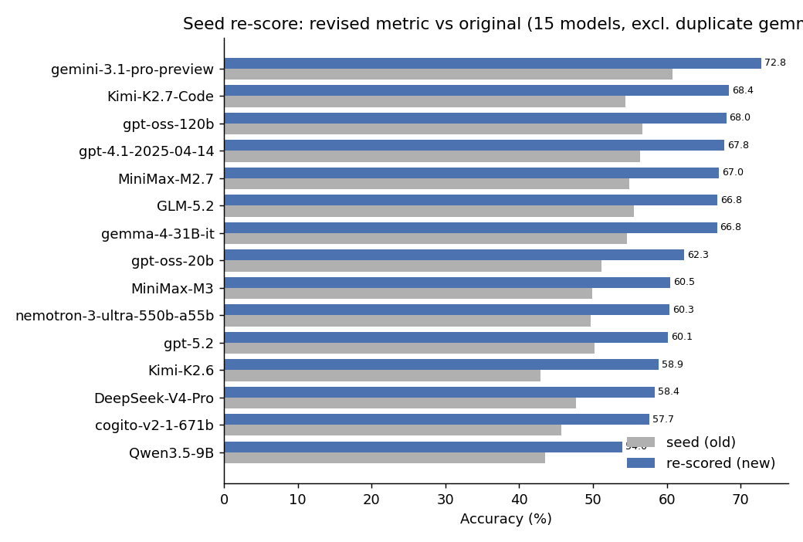

# Seed-phase report & critical analysis (revised scoring)

*LLM structured-extraction pipeline — systematic-review coding of ML-in-psychology papers.*
*Supersedes the initial exact-match report. Companion to `scoring_scheme.md`.*

---

## 1. What the seed phase is (and is not)

The **seed phase** evaluates **each model once**, with a **single fixed pipeline configuration**, on the
**35-paper tuning set × 43 codebook items**. It is the foundation of the Optuna TPE study (its first
startup trials) and an early **preview of RQ1.5** (which model extracts best). It is **not** the final
model comparison — that comes from the full hyperparameter search, comparing each model at its *best* config.

This revision re-scores the same saved model outputs under the **corrected metric** built after the first
report exposed systematic mis-evaluations. **No extraction model was re-run** — the only new inference is
the open-ended judge (see §2). Roster: **15 models** (`pearl-ai/gemma-4-31b-it` dropped as a near-duplicate;
`claude-opus-4-8` deferred — Anthropic credit).

---

## 2. The corrected metric (vs the first report)

| Item type | First report | **Revised** |
|---|---|---|
| **MC, non-curated (17)** | strict exact set-match vs the rater **union** | **`I ⊆ P ⊆ U`** — prediction must include the raters' **intersection** and stay within their **union** (letters only), from the per-rater data |
| **MC, curated (3.1/4.1/4.2/4.3)** | exact + Other-judge gate | **exact set-match, letters-only** (Other-judge → a *secondary* score) |
| **Dependency-NA** | model `-99` vs gold `'0'` → wrong | **reconciled**: `-99`/`-96`/`0`/abstain all = not-applicable |
| **List (0.7.3)** | exact set-match; gold `['0']` vs model `Z` → wrong | + **`['0']`/NA + abstain → correct** |
| **Gold→option mapping** | on-the-fly; abbreviations → phantom-`Y` | **reviewed map** (`analysis/translation_list.csv`): 5 aliases, 4.7 `C→Y` |
| **Open-ended judge** | Phi-3-mini (empty scored correct; case-sensitive; superset-penalized) | **gpt-oss-120b via Together API**, empty→wrong, case-insensitive, superset-relaxed |

**The judge is now an API call, not a 15 GB local model.** `JUDGE_BACKEND=together`,
`EQUIV_JUDGE_MODEL=openai/gpt-oss-120b`. On a labeled test set it beat Phi-3-mini on every failure case
(6/6 open-ended pairs + all the paraphrase/superset/empty cases Phi-3 got wrong). This removed the local
OOM risk entirely and upgraded judge quality.

The production objective is the **letters-only primary** and never invokes the judge in the hot path
(the Other free-text judged-secondary is opt-in via `MC_JUDGE_SECONDARY=1`). The same rules live in
`src/mc_rule.py`, shared by the offline re-scorer and the live `src/evaluate.py` — the live path was
**verified to reproduce the re-scorer on 4,200/4,200 cells**.

**Reasoning provenance (a confound):** the seed set `disable_reasoning=True`, honored only by Together
models. So **13 models ran thinking-OFF**, while **gpt-5.2 and gemini ran thinking-ON** (they ignore the
flag). Not like-for-like on that axis; `objective.py` now records the *effective* mode per trial and only
offers the toggle to models that can actually toggle.

---

## 3. Results (revised)

**Mean accuracy 51.6% → 63.3%** across 15 models (revised → original):

| # | Model | new | old | | # | Model | new | old |
|---|---|---|---|---|---|---|---|---|
| 1 | **gemini-3.1-pro**† | **72.8** | 60.8 | | 9 | MiniMax-M3 | 60.5 | 49.9 |
| 2 | Kimi-K2.7-Code | 68.4 | 54.4 | | 10 | nemotron-3-550b | 60.3 | 49.7 |
| 3 | gpt-oss-120b | 68.0 | 56.7 | | 11 | gpt-5.2† | 60.1 | 50.2 |
| 4 | gpt-4.1 | 67.8 | 56.4 | | 12 | Kimi-K2.6 | 58.9 | 42.9 |
| 5 | MiniMax-M2.7 | 67.0 | 54.9 | | 13 | DeepSeek-V4-Pro | 58.4 | 47.7 |
| 6 | GLM-5.2 | 66.8 | 55.5 | | 14 | cogito-v2-671b | 57.7 | 45.6 |
| 7 | gemma-4-31B-it | 66.8 | 54.5 | | 15 | Qwen3.5-9B | 54.0 | 43.5 |
| 8 | gpt-oss-20b | 62.3 | 51.1 | | | | | |

† ran with reasoning ON (§2). Every model gains **+10 to +16 pts**; the ordering is broadly stable but
**not like-for-like** (§4).

**By question type:**

| Type | old → new |
|---|---|
| multiple_choice (21) | **46.5% → 66.5%** |
| open_ended (2) | **15.2% → 36.4%** (1.3 → 23.6, 1.7 → 49.1; gpt-oss-120b judge) |
| list (1) | **12.1% → 46.7%** (the `['0']` fix) |
| single_choice (10) | 58.5% → 58.5% (unchanged) |
| numeric (9) | 69.1% → 69.2% |

**Biggest per-item corrections:** 3.4.1 nesthand **26.9 → 95.8** (dependency-NA), 3.5.1 +37, 0.7.3 packages
+35, 3.5 +34, 4.7 sig +32 (`C→Y`), 2.3 enrich +32, **5.2 limit 4.2 → 29.7** (`I⊆P⊆U` + IML alias +
no phantom-Y), 1.7 predtask +29 (judge swap). Full tables: `analysis/rescore_seed_per_{model,item}.csv`.

---

## 4. Remaining weaknesses & caveats

The corrected metric removed the **mis-evaluations** (dependency convention, phantom-Y, exact-vs-union
harshness, Other double-jeopardy, list-NA, and the Phi-3 judge's empty-FP / paraphrase failures). What
still stands:

- **Reasoning-mode confound (unresolved for the seed).** gpt-5.2 and gemini ran thinking-ON, the other 13
  OFF. gemini's #1 is under that asymmetry. The TPE run's model-aware toggle fixes it going forward.
- **n = 1, non-deterministic.** One draw per model; no variance/CI. Clusters within a few points (e.g.
  ranks 6–7 at 66.8) are not separable.
- **Judge test set is small.** gpt-oss-120b is validated on 6 labeled open-ended pairs + the Phi-3 failure
  cases — enough to rule out weaker judges and confirm it's strong, but not a fine-grained ranking of the
  top candidates. Open-ended 1.3 (sample) at 23.6% is still low: sample descriptions vary widely.
- **`I ⊆ P ⊆ U` leniency (a documented choice).** When raters share no code (`I=∅`) an empty answer passes
  — per the agreed rule (a model may side with either disagreeing rater). Deliberate, not a bug.
- **Judged-secondary MC** (Other free-text must match) computed as a robustness check
  (`analysis/rescore_secondary_per_item.csv`): non-curated MC **69.5% → 67.2%** (~2.3pp; 164 of 343
  Other-cells fail the content judge, ≈1.8pp of MC, ≈**0.7pp on the 63.3% headline**). Drivers: **4.7 sig
  −18.5** and **5.2 limit −7.6**. The 4.7 Other text was recovered by re-running its follow-up per model
  (`analysis/rerun_47_followup.py`, 266 cells, since the seed predated the C→Y rename); its drop is *real*,
  not an artifact — models list the *statistical tests* ("binomial, FDR, Benjamini-Hochberg") while the gold
  codes the *result-type* the test was for, a genuine item/follow-up interpretation mismatch worth flagging
  in the codebook. The letters-only primary remains the headline (Other content costs only ~0.7pp).
- **Single fixed config + PyMuPDF-only.** One point in the search space; the other 5 parsers unused.
  Seed ≠ final per-model-best comparison.
- **Logprobs available for 11/15 models** (all Together + gpt-4.1) at ~96–98% coverage — calibration
  analysis is possible on that subset; the 5 no-logprob models (Kimi×2, gpt-5.2, gemini) returned none.
- **Absolute levels are metric-specific** — 63.3% is meaningful only within this metric/gold.

---

## 5. Reproduce
`pipeline_env/bin/python analysis/rescore_seed.py` → per-model/item/type CSVs + `figures/rescore_ranking.png`.
Open-ended re-judge: `analysis/rerun_oe_judge.py [--write]` (uses `JUDGE_BACKEND`/`EQUIV_JUDGE_MODEL` from
`.env`). Gold map: `analysis/translation_list.csv` (auto-read by `src/evaluate.py`). Shared rules:
`src/mc_rule.py` (live scorer + re-scorer). Pristine pre-rewrite baseline: `analysis/seed_original_*.csv`.
